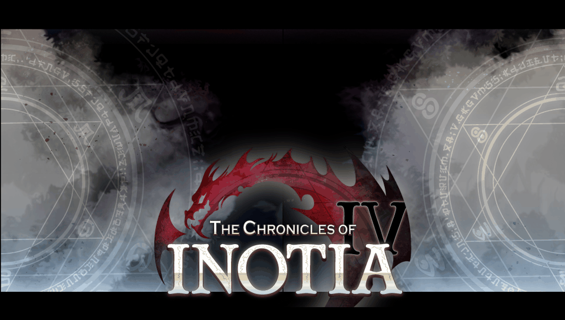

<h1 align="center">
  <br>
  Inotia 4: Assassin of Berkel · PS Vita Port
</h1>

<p align="center">
  <b>Native port of Inotia 4: Assassin of Berkel (Com2uS) for PlayStation Vita and PlayStation TV.</b>
</p>

<p align="center">
  
  
  
  
  
  
</p>

<p align="center">
  <a href="#-description">Description</a> •
  <a href="#-features">Features</a> •
  <a href="#-controls">Controls</a> •
  <a href="#-installation">Installation</a> •
  <a href="#-known-issues">Known Issues</a> •
  <a href="#-building-from-source">Build</a> •
  <a href="#-credits">Credits</a>
</p>

---

## 📖 Description

An unofficial, native **iOS-to-PS Vita wrapper port** of *Inotia 4: Assassin of Berkel* (originally developed by **Com2uS**). There is no ELF of the game here: this port ships its own **Mach-O loader** that maps the official ARMv7 executable (`Inotia4_global`, armv7 slice of the 1.0.3 IPA) into PS Vita RAM and replaces the Apple frameworks it uses (Foundation, UIKit, CoreGraphics/CoreText, AudioToolbox, OpenGL ES 1.1) with native implementations on top of **vitaGL**, **FreeType** and the Vita system libraries. The game's own FMOD audio engine runs unchanged on top of an emulated AudioUnit.

---

## 🎮 Status & Playability

**Status: Playable (beta) (v0.1)** — on physical PlayStation Vita hardware the game boots, reaches the title
screen, creates a character, plays in-game, and saves and loads.

- [x] **Mach-O loader**: maps the image `0x1000–0x3DE000` at `0x98001000` (`MACHO_SLIDE`), applies 49,882 rebase words, resolves 6,201 import slots (117 left as logging stubs), registers the game's 492 Objective-C classes and runs its 46 static initializers. *Verified on console.*
- [x] **Graphics**: OpenGL ES 1.1 on vitaGL. The game renders its iPhone layout into a 480×320 drawable, scaled to 816×544, centered with side borders to keep the 3:2 aspect. *Verified on console.*
- [x] **Text & Fonts**: UIKit/CoreText text is drawn with FreeType from a bundled `font.ttf` (NanumGothic), with cached glyphs. Accented Latin characters are included. *Verified on console.*
- [x] **Touch & Controls**: front touch screen, plus physical buttons mapped to the on-screen D-pad, attack, skill slots, potion and options through `controls.txt`. *Verified on console.*
- [x] **Saves**: progress is written to `ux0:data/inotia4ios/Documents/` (the game's per-account save folder is created automatically). Save and load *verified on console.*
- [x] **Options menu**: **Start + Select** opens a port menu (game paused) to remap buttons, show/hide the on-screen controls, change the game speed and the text language. *Verified on console.*
- [ ] **FPS counter & FPS limit**: two new rows in the Start + Select menu — an on-screen FPS counter (top-left) and an optional 30 FPS limit, saved as `SHOWFPS` / `FPSCAP` in `controls.txt`. *New, not yet tested on console.*
- [x] **Game speed**: 16 (original) / 23 / 25 / 30 FPS, saved in `config.txt`. The game logic runs per frame, so a higher setting also makes the game faster.
- [x] **Spanish / Portuguese translation**: menus, items, skills, monsters, maps, quests, system messages and story dialogue, from a separate translation pack (see Setup). Switchable live from the options menu.
- [ ] **Performance**: CPU at 444 MHz; the game's own logic takes about 30–40 ms per frame on the Vita (GPU time is under 2 ms). 16 and 23 FPS are mostly steady; 25–30 FPS drop in busy scenes (see Known Issues).

### 📋 Changelog (v0.1)

First public build of the native iOS-to-PS Vita wrapper port. It adds an options menu with button remapping,
game speed and a Spanish / Portuguese translation. Release notes: [`RELEASE.md`](RELEASE.md).

---

## ✨ Features

| Feature | Status | Notes |
| :--- | :---: | :--- |
| Boots to gameplay | ✅ | Title screen, character creation and in-game play verified on hardware |
| Graphics / renderer | ✅ | OpenGL ES 1.1 on vitaGL; 480×320 drawable scaled to 816×544 with side borders |
| Audio & music | 🧪 | FMOD Ex over an emulated AudioUnit (`coreaudio.c`); not listed as verified on console |
| Video / cutscenes | ➖ | Not documented in this port |
| Physical buttons | ✅ | Attack, skills, potion and options through `controls.txt` |
| Analog sticks / camera | ✅ | Left stick drags the on-screen D-pad to move |
| Touch screen | ✅ | Front touch screen drives the game controls |
| Button remapping / port menu | ✅ | Start + Select port menu: remap, on-screen controls, game speed, language |
| Save data | ✅ | `ux0:data/inotia4ios/Documents/`; save and load verified on console |
| Native trophies | ➖ | Not implemented |
| Languages | 🧪 | Spanish / Portuguese translation pack, switchable live; not listed as verified on console |
| Performance | 🟡 | Game logic takes about 30–40 ms per frame; 25–30 FPS drop in busy scenes |
| Online / IAP / ads | ➖ | Com2uS Hub login, news, in-app purchases and "MORE GAMES" are not available |
| PS TV | 🧪 | Listed in the platform badge; no separate PS TV test recorded |

Legend: `✅ Working (verified on console) · 🧪 Implemented, not yet verified on console · 🟡 Partial · ❌ Not working · ➖ Not applicable · ❔ Not documented yet`

---

## 🎯 Controls

| Input | Action | Status |
| :---: | :--- | :---: |
| **Touch screen** | Game touch controls | ✅ Working |
| **Left stick / D-Pad** | Move (drags the on-screen D-pad) | ✅ Working |
| **Cross (✕)** | Attack | ✅ Working |
| **Square / Triangle / Circle / L / R** | Skill and item slots around the attack button | ✅ Working |
| **Select** | Potion | ✅ Working |
| **Start** | Game options (gear icon) | ✅ Working |
| **Start + Select** | Port options menu (remap, on-screen controls, aspect, filter, FPS counter, FPS limit, speed, language) | ✅ Working (FPS rows: 🧪 New) |
| **L + R** | Show / hide the on-screen D-pad, attack and skill buttons | ✅ Working |

> [!TIP]
> Every button is a touch on a screen point defined in `ux0:data/inotia4ios/controls.txt` (480×320 coordinates, up to 10 buttons plus `STICK x y radius`, with the action name at the end of each line). Remap them from the options menu or edit the file over FTP. Start and Select alone act when released, so the Start + Select menu combo never presses them. Holding **Select + Start** for 2 s rotates the image (saved in `rotation.txt`). The on-screen controls start hidden and keep working when touched.

---

## 📋 Prerequisites

1. **CFW & Plugins**: PS Vita on Custom Firmware (**Enso 3.60 / 3.65** recommended) with **kubridge** in `ur0:tai/config.txt`:
   ```ini
   *KERNEL
   ur0:tai/kubridge.skprx
   ```
2. **Shader Compiler**: `libshacccg.suprx` must be in `ur0:data/` (extract it with **ShaRKBR33D**).
3. **Game Files**: a decrypted *Inotia 4* **1.0.3** IPA (`Inotia4_global`, `cryptid 0`). On a PC with Python 3 (with the `lzma` module, + `capstone`), clone this repo, extract `Payload/Inotia4_global.app/` and run:
   ```bash
   tools/stage_data.sh path/to/Inotia4_global.app
   ```
   It builds `ux0_data/inotia4ios/`: the app bundle plus `rebase.bin` / `binds.bin` (also attached to the release).
4. **Translation (optional)**: unzip `inotia4-translation-es-pt.zip` from the release and run the same script with `TRANSLATION` pointing at it. It writes `memorytext_es.dat` and `memorytext_pt.dat` next to the game's English text:
   ```bash
   TRANSLATION=path/to/inotia4-translation tools/stage_data.sh path/to/Inotia4_global.app
   ```

---

## 📦 Installation

1. **Copy to the Vita** (`ux0:data/inotia4ios/`):
   ```
   ux0:data/inotia4ios/
     game_app/      the app bundle (executable + data; memorytext_es/pt.dat if translated)
     rebase.bin     relocation table for the 1.0.3 executable
     binds.bin      import slots resolved by the loader
     controls.txt   button -> touch mapping (also editable from the options menu)
     config.txt     created automatically — game speed and text language
     Documents/     created automatically — your saves
     logs/          created automatically — inotia4ios_NNN.log, one per run
   ```
2. **Install VPK**: install `inotia4ios.vpk` with VitaShell.

### Final File Structure in `ux0:data/inotia4ios/`

```text
ux0:data/inotia4ios/
├── game_app/      <- App bundle (executable, data; memorytext_es/pt.dat if translated)
├── rebase.bin     <- Relocation table for the 1.0.3 executable
├── binds.bin      <- Import slots resolved by the loader
├── controls.txt   <- Button -> touch mapping (editable from the options menu)
├── config.txt     <- Game speed and text language (created automatically)
├── rotation.txt   <- Image rotation (Select + Start held for 2 s)
├── Documents/     <- Your saves (created automatically)
└── logs/          <- inotia4ios_NNN.log, one per run
```

### ⚙️ Options

The Start + Select port menu writes `controls.txt` (buttons, on-screen controls, `SHOWFPS` / `FPSCAP`), `config.txt` (game speed and language) and `rotation.txt`. Speed choices are 16 (original), 23, 25 and 30 FPS.

---

## 🐛 Known Issues

- **"MORE GAMES" on the main menu crashes the game**: it is an online Com2uS catalog; the cause is not fixed yet. Don't press it.
- **Frame drops at 25–30 FPS**: the game's logic is the bottleneck (about 30–40 ms per frame on the Vita's CPU, the original ran at about 16 FPS). Because the logic is tied to the frame rate, drops also slow the game down. Map loads take up to a few seconds.
- **Translation uses the English slot**: Spanish/Portuguese replace the English text, so the game's own language must be English. Each live language switch keeps the previous text in memory (about 600 KB). Nobody has proofread the translation yet, and a few long item or map names may not fit their boxes.
- **Online features disabled**: the Com2uS Hub login, news, in-app purchases and "MORE GAMES" are not available; the terms-of-use screen is skipped.
- **Logs** are written to `ux0:data/inotia4ios/logs/` (fetch them with `tools/deploy_data.py --logs`). **Crash dumps** are written by the system to `ux0:data/` (not to the game folder).

---

## 🔨 Building from Source

### Prerequisites

- [VitaSDK](https://vitasdk.org/) (`$VITASDK`) with `kubridge`, FreeType, libpng and zlib.
- CMake 3.14+, Python 3 with `lzma` and `capstone` (for the tools).
- A decrypted 1.0.3 IPA, extracted locally (never committed; `game_app` is a symlink to the `.app`).

### Compilation Commands

```bash
git clone https://github.com/MetalSyntax/Inotia4-iOS-vita.git
cd Inotia4-iOS-vita
tools/stage_data.sh game_app
cmake -S . -B build
cmake --build build
```

### Deploy & Debug

```bash
python3 -I tools/deploy_data.py          # sync ux0_data/inotia4ios/ to the Vita over FTP (VitaShell, port 1337)
python3 -I tools/deploy_data.py --logs   # fetch logs/inotia4ios_NNN.log and .psp2dmp crash dumps
```

A crash at `PC = X` maps to `X - 0x98000000` in the armv7 slice (`lipo -thin armv7 game_app/Inotia4_global -output build/Inotia4_armv7`); `tools/annotate.py build/Inotia4_armv7 <symbol>` prints the annotated disassembly. Game-specific patches live in `source/patch.c`. Translation tools: `tools/translate/` (`extract.py`, `check.py`, `build.py`). Architecture and progress notes: [`PORTING_PLAN.md`](PORTING_PLAN.md) and [`port_progress.md`](port_progress.md).

---

## 📁 Project Structure

- `source/`: Mach-O loader, Objective-C/UIKit and CoreText runtime, vitaGL renderer, audio (`coreaudio.c`), input, game patches (`patch.c`).
- `tools/`: `stage_data.sh`, `ios_prep.py`, `deploy_data.py`, `annotate.py`, `translate/` (`extract.py`, `check.py`, `build.py`).
- `translation/`: Spanish and Portuguese translation chunks (`chunk*.{en,es,pt}.json`).
- `font.ttf`: bundled NanumGothic font used by the FreeType text renderer.
- `extras/livearea/`: LiveArea assets.
- `game_app/`: local symlink to the decrypted `.app` (never committed).
- `PORTING_PLAN.md`: Architecture and plan. `port_progress.md`: progress log. `RELEASE.md`: release notes.

---

## 📜 Disclaimer

**Inotia** is a registered trademark of **Com2uS Corp.** The work presented in this repository is unofficial and is not produced, endorsed, or sanctioned by Com2uS or any affiliated entities.

This software does NOT contain original game code, binaries, copyrighted graphics, or game assets. The authors do not promote or condone piracy in any way. To play, you must provide your own legally obtained, **decrypted** copy of the iOS `.ipa`.

---

## ☕ Support My Work

This project is **free** and will stay free. If you enjoy it, a tip from **$1** helps me keep porting games to the PS Vita:

<p align="center">
  <a href="https://ko-fi.com/metalsyntax"></a>
</p>

- **Ko-fi:** [ko-fi.com/metalsyntax](https://ko-fi.com/metalsyntax)
- **PayPal:** [paypal.me/MetalSyntax](https://paypal.me/MetalSyntax)
- **Bitcoin (BTC):** `133HdCsaWxdjTfmwpgGVykByhNBV338uRc`

**Ko-fi supporters get:**
- **Early access** to new ports before their public release (test builds of upcoming projects).
- **Data preparation scripts and step-by-step guides** to set up your own game files for each new port.
- A say in which games I port next.

> Game files are never distributed. You always need your own legally obtained copy of the game.

---

## 👥 Credits

- **Inotia 4: Assassin of Berkel** is intellectual property of **Com2uS Corp.**
- **vitaGL** graphics library by [Rinnegatamante](https://github.com/Rinnegatamante/vitaGL).
- **kubridge** plugin by [Bythos](https://github.com/bythos14/kubridge).
- **FreeType** and the **NanumGothic** font (SIL OFL).
- The Mach-O loader and runtime are shared with [Zenonia 5](https://github.com/MetalSyntax/Zenonia5-psvita-port); sibling ports: [Inotia 3](https://github.com/MetalSyntax/Inotia3-vita) (game-speed and save handling reference), [Zenonia 2](https://github.com/MetalSyntax/Zenonia2-psvita-port) (options menu and translation reference).
- Special thanks to the PS Vita homebrew and porting community.

---

## 📄 License

No `LICENSE` file is present in this repository. <!-- TODO: add the license under which this port is distributed, or confirm none. -->
